# Design Document

## Overview

Este documento descreve o design do **Documentation_Set**: um conjunto de documentação de referência, escrito em português, que cobre o Amazon SQS, o AWS Lambda e o padrão de integração SQS-para-Lambda. Neste design, o "sistema" a ser projetado é a própria documentação — sua estrutura, seus contratos de conteúdo, seus modelos de dados recorrentes (templates), seu tratamento de informação potencialmente volátil e sua estratégia de validação. Não há software em tempo de execução; os artefatos produzidos são documentos Markdown navegáveis.

**Objetivo.** Entregar material de referência preciso, previsível e rastreável, que permita a um Reader (desenvolvedor ou arquiteto) aprender ou consultar rapidamente cada serviço e o padrão de integração, e que permita a um Author manter o conteúdo de forma consistente ao longo do tempo.

**Público-alvo.** Desenvolvedores e arquitetos que estão aprendendo ou consultando o Amazon SQS, o AWS Lambda e sua integração. O conteúdo pressupõe familiaridade geral com a AWS, mas não com esses serviços específicos.

**Como o design satisfaz os requisitos.** O design mapeia cada seção estrutural aos requisitos aprovados:

- A **Architecture** define a estrutura de três documentos, o índice/sumário, o glossário compartilhado, a hierarquia de cabeçalhos idêntica e as seis subseções obrigatórias por serviço — satisfazendo o **Requisito 1**.
- A seção **Components and Interfaces** define o contrato de conteúdo de cada subseção de cada documento, mapeado aos **Requisitos 2 a 9**, além dos modelos de citação, de exemplos de código e de terminologia consistente.
- **Data Models** define os templates recorrentes (subseção, entrada de glossário, citação, bloco de exemplo, tabela de limites) que dão uniformidade ao conjunto — apoiando os **Requisitos 1, 4, 7 e 10**.
- **Error Handling** define como a documentação trata informação potencialmente desatualizada, links quebrados, valores que a AWS pode alterar e não conformidade estrutural — satisfazendo os **Requisitos 1.4, 4.5, 7.2, 10.1, 10.2 e 10.4**.
- **Testing Strategy** define os critérios de revisão/validação verificáveis que confirmam a conformidade com os requisitos — com foco especial nos **Requisitos 1 e 10**.

Por se tratar de um entregável de documentação (e não de código com funções puras, parsers, serializadores ou algoritmos), o **property-based testing (PBT) não é aplicável**. A seção Correctness Properties é, portanto, intencionalmente omitida; a validação é expressa como critérios de revisão verificáveis na Testing Strategy (ver justificativa no início daquela seção).

## Architecture

### Estrutura de arquivos

O Documentation_Set é organizado como um conjunto de documentos Markdown sob um diretório de documentação. A estrutura de arquivos separa cada documento de nível superior em um arquivo próprio, com um índice (sumário) e um glossário compartilhados, satisfazendo o **Requisito 1.1** (três seções navegáveis separadamente, acessíveis a partir de um índice) e o **Requisito 1.6** (glossário compartilhado).

```
docs/
├── index.md                 # Índice/sumário + Introdução (Requisito 1.1, 1.2)
├── glossario.md             # Glossário compartilhado (Requisito 1.6, 10.3)
├── sqs.md                   # SQS_Document (Requisitos 2, 3, 4)
├── lambda.md                # Lambda_Document (Requisitos 5, 6, 7)
└── integracao-sqs-lambda.md # Integration_Document (Requisitos 8, 9)
```

> Nota de implementação: os nomes de arquivo são uma convenção do design. Se o Author preferir um único arquivo com âncoras de seção, a mesma hierarquia de cabeçalhos e as mesmas subseções devem ser preservadas, pois a conformidade é avaliada pela estrutura de cabeçalhos (ver Testing Strategy), não pela contagem de arquivos.

### Hierarquia de documentos e subseções

Cada documento que cobre um serviço (SQS_Document e Lambda_Document) é organizado **exatamente** nas seis subseções obrigatórias, **nesta ordem** (**Requisito 1.3**):

1. Conceitos Principais
2. Introdução / Implementação
3. Dicas e Observações Importantes
4. Limites e Cotas
5. Segurança
6. Considerações de Preço

O Integration_Document cobre um padrão (não um serviço isolado), portanto não é obrigado às seis subseções; ele é organizado pelos temas dos **Requisitos 8 e 9** (Event_Source_Mapping e batching; tratamento de erros e idempotência), mas reutiliza as mesmas convenções de cabeçalho, citação e exemplo.

Todos os três documentos usam uma **hierarquia de cabeçalhos idêntica**, na qual cada subseção equivalente aparece no mesmo nível de cabeçalho em todos os documentos (**Requisito 1.5**): título do documento em `#` (H1), subseções obrigatórias em `##` (H2), e detalhamentos em `###` (H3).

```mermaid
graph TD
    DS["Documentation_Set"] --> IDX["index.md — Índice + Introdução<br/>(público-alvo, escopo, serviços cobertos)"]
    DS --> GL["glossario.md — Glossário compartilhado"]
    DS --> SQS["SQS_Document (sqs.md)"]
    DS --> LMB["Lambda_Document (lambda.md)"]
    DS --> INT["Integration_Document (integracao-sqs-lambda.md)"]

    SQS --> S1["## Conceitos Principais"]
    SQS --> S2["## Introdução / Implementação"]
    SQS --> S3["## Dicas e Observações Importantes"]
    SQS --> S4["## Limites e Cotas"]
    SQS --> S5["## Segurança"]
    SQS --> S6["## Considerações de Preço"]

    LMB --> L1["## Conceitos Principais"]
    LMB --> L2["## Introdução / Implementação"]
    LMB --> L3["## Dicas e Observações Importantes"]
    LMB --> L4["## Limites e Cotas"]
    LMB --> L5["## Segurança"]
    LMB --> L6["## Considerações de Preço"]

    INT --> I1["## Event_Source_Mapping e Batching"]
    INT --> I2["## Tratamento de Erros e Idempotência"]
```



### Índice / Sumário e Introdução

O `index.md` contém:

- Uma **seção de introdução** que declara o público-alvo, o escopo de cobertura e uma **lista enumerada** dos serviços cobertos, contendo no mínimo Amazon SQS, AWS Lambda e sua integração (**Requisito 1.2**).
- Um **índice (sumário)** com links para as três seções de nível superior e para suas subseções (**Requisito 1.1**).

### Glossário compartilhado

O `glossario.md` define **cada termo específico da AWS** usado nos três documentos, com **exatamente uma entrada por termo** (**Requisito 1.6**). O glossário é a fonte única de verdade para a terminologia; os três documentos referenciam esses termos de forma consistente, sem sinônimos intercambiáveis (**Requisito 10.3**). O conjunto inicial de termos deriva do glossário dos requisitos (Amazon SQS, AWS Lambda, Standard_Queue, FIFO_Queue, DLQ, Visibility_Timeout, Event_Source_Mapping, Partial_Batch_Response, Idempotency, maxReceiveCount, GB-seconds, Ephemeral storage).

### Estratégia de citações para fontes oficiais da AWS

Toda afirmação factual sobre **limite, cota, preço ou comportamento** deve incluir uma **Citation** — um link para a página específica da documentação oficial da AWS que a embasa (**Requisitos 10.1 e 10.2**). A estratégia de citação:

- Fontes permitidas: apenas `docs.aws.amazon.com` e `aws.amazon.com`.
- Formato: link Markdown inline imediatamente após a afirmação, ou nota de rodapé/lista de referências ao fim da subseção.
- Valores voláteis (padrões de cota, preços, runtimes suportados) recebem, além da citação, uma **nota de verificação** aconselhando o Reader a confirmar o valor atual na documentação oficial (**Requisito 10.4**).

## Components and Interfaces

Cada documento é tratado como um **componente**. A "interface" de cada componente é o **contrato de conteúdo** de suas subseções: o que a subseção deve conter e a quais critérios de aceitação ela responde. Convenções transversais (citação, exemplos, terminologia) aplicam-se a todos os componentes.

### Componente: SQS_Document (`sqs.md`)

| Subseção (nível `##`) | Contrato de conteúdo | Requisitos |
|---|---|---|
| Conceitos Principais | Definir Amazon SQS como serviço de filas totalmente gerenciado (desacoplar/escalar, produtores e consumidores assíncronos sem conexão direta); ciclo de vida da mensagem em estágios ordenados (envio → armazenamento → recebimento → janela de Visibility_Timeout → exclusão explícita); redirecionamento para DLQ quando a mensagem excede o maxReceiveCount; comparação Standard_Queue vs. FIFO_Queue (ordenação, garantia de entrega, throughput); definição de Visibility_Timeout, retenção, atraso de entrega e DLQ com padrão e faixa; critérios de decisão SQS vs. SNS vs. MQ. | 2.1, 2.2, 2.3, 2.4, 2.5, 2.6 |
| Introdução / Implementação | Passos numerados e ordenados: criar fila → enviar → receber → excluir, cada um com entradas necessárias e resultado observável; ≥1 exemplo completo de envio e ≥1 de recebimento (código ou CLI) com saída de sucesso esperada; configuração de DLQ e maxReceiveCount (faixa inteira 1–1000); payloads > 256 KB via armazenamento externo (Amazon S3) com a condição que exige a abordagem. | 3.1, 3.2, 3.3, 3.4, 3.5 |
| Dicas e Observações Importantes | Boas práticas operacionais e advertências (ex.: escolha de tipo de fila, uso de long polling, dimensionamento de Visibility_Timeout), com notas de verificação onde couber. | Apoia 2.x, 3.x |
| Limites e Cotas | Tamanho máximo de mensagem 256 KB; retenção de 60 s a 1.209.600 s (14 dias), padrão 4 dias; rótulo explícito de cada limite como ajustável ou fixo (hard limit). | 4.1, 4.5 |
| Segurança | Criptografia do lado do servidor (SSE-SQS com chaves gerenciadas pelo SQS; SSE-KMS com chaves gerenciadas pelo cliente no AWS KMS); controle de acesso com políticas baseadas em identidade do IAM e políticas de fila baseadas em recurso, explicando o que cada uma governa. | 4.2, 4.3 |
| Considerações de Preço | Modelo pay-per-request; principais fatores de custo (número de solicitações de API e tratamento de payloads grandes); nota de verificação de preço. | 4.4, 10.4 |

### Componente: Lambda_Document (`lambda.md`)

| Subseção (nível `##`) | Contrato de conteúdo | Requisitos |
|---|---|---|
| Conceitos Principais | Definir AWS Lambda como computação serverless orientada a eventos, sem provisionar/gerenciar servidores; handler, fontes de eventos/gatilhos e modelo de ambiente de execução (o que é e papel na invocação); modelo de concorrência (um pedido por vez por ambiente; escala criando ambientes concorrentes); cold start vs. warm start; duração máxima de invocação de 15 min (900 s) e timeout padrão. | 5.1, 5.2, 5.3, 5.4, 5.5 |
| Introdução / Implementação | Passos numerados: criar função → configurar gatilho → implantar código → invocar, cada um com ação e resultado observável; ≥1 exemplo completo de handler em runtime suportado (assinatura, parâmetro de entrada, valor de resposta); configuração de memória e timeout com faixas permitidas e efeito no desempenho/custo; como ver logs e métricas (≥1 fonte de log e ≥1 métrica); solução de problemas para os passos de criação e invocação (condição de falha + ação corretiva). | 6.1, 6.2, 6.3, 6.4, 6.5 |
| Dicas e Observações Importantes | Recomendações de desempenho, dimensionamento de memória/timeout, reuso de ambiente de execução; notas de verificação onde couber. | Apoia 5.x, 6.x |
| Limites e Cotas | Cotas principais com valor/faixa e unidade: duração máxima de invocação, faixa de alocação de memória, faixa de ephemeral storage, limite padrão de execuções concorrentes por conta; indicação, para cada cota, se é ajustável (via solicitação de aumento de cota) ou hard limit. | 7.1, 7.2 |
| Segurança | Papel de execução (concede acesso a outros serviços da AWS; deve seguir privilégio mínimo); segredos e variáveis de ambiente (criptografadas em repouso; valores sensíveis em serviço dedicado de gerenciamento de segredos, não em texto plano). | 7.3, 7.4 |
| Considerações de Preço | Preço em função de número de solicitações e duração de computação em GB-seconds (memória configurada × tempo de execução); unidades e comportamento de arredondamento do tempo faturável; nota de verificação de preço. | 7.5, 7.6, 10.4 |

### Componente: Integration_Document (`integracao-sqs-lambda.md`)

| Subseção (nível `##`) | Contrato de conteúdo | Requisitos |
|---|---|---|
| Event_Source_Mapping e Batching | Event_Source_Mapping: Lambda faz polling do SQS e invoca a função de forma síncrona com lote de 1–10.000 mensagens (Standard_Queue) e 1–10 (FIFO_Queue); suporte a Standard_Queue e FIFO_Queue como fontes de eventos; batching (tamanho do lote e janela de lote de 0 a 300 s); função e fila na mesma Região da AWS, podendo estar em contas diferentes; lote bem-sucedido → exclusão das mensagens; Visibility_Timeout ≥ timeout da função; erro/timeout → mensagens não excluídas, revisíveis após expiração do Visibility_Timeout; Visibility_Timeout < timeout da função → risco de processamento duplicado. | 8.1, 8.2, 8.3, 8.4, 8.5, 8.6, 8.7 |
| Tratamento de Erros e Idempotência | Processamento at-least-once (duplicatas possíveis); recomendação de código idempotente com definição de Idempotency; Partial_Batch_Response (lista de IDs de mensagens que falharam; só elas são reprocessadas; as bem-sucedidas saem da fila); DLQ ao atingir maxReceiveCount (captura, retém para inspeção, impede reprocessamento na origem); Visibility_Timeout ≥ timeout da função, com proporção recomendada de ≥ 6× o timeout; resposta de Partial_Batch_Response malformada/vazia → lote inteiro tratado como falha e todo reprocessado. | 9.1, 9.2, 9.3, 9.4, 9.5, 9.6 |

### Interface transversal 1: Modelo de citação

Contrato aplicável a todos os componentes (**Requisitos 10.1, 10.2**):

- Uma Citation é um link Markdown para uma página específica em `docs.aws.amazon.com` ou `aws.amazon.com`.
- Toda afirmação sobre limite, cota, preço ou comportamento carrega uma Citation adjacente.
- Formato preferencial: `[texto descritivo](https://docs.aws.amazon.com/...)`.

### Interface transversal 2: Modelo de exemplos de código

Contrato aplicável a todos os componentes (**Requisito 10.5**):

- Todo exemplo de código ou CLI aparece em um bloco delimitado (fenced) anotado com identificador de linguagem/shell (ex.: ```` ```bash ````, ```` ```python ````, ```` ```json ````).
- Exemplos de operações do SQS (envio/recebimento) e de handler do Lambda incluem a saída/resposta de sucesso esperada, para que o Reader verifique o resultado (**Requisitos 3.3, 6.2**).

### Interface transversal 3: Convenções de terminologia consistente

Contrato aplicável a todos os componentes (**Requisitos 1.5, 1.6, 10.3**):

- Cada conceito é referido pelo mesmo termo do glossário em todos os documentos (sem sinônimos intercambiáveis).
- Nomes de serviços da AWS e termos técnicos do glossário permanecem em inglês (Amazon SQS, AWS Lambda, Event_Source_Mapping, Visibility_Timeout, Partial_Batch_Response, maxReceiveCount, DLQ, Standard_Queue, FIFO_Queue, GB-seconds, Ephemeral storage).
- As palavras-chave EARS (THE, WHEN, IF/THEN, WHERE, SHALL) permanecem em inglês quando os critérios são referenciados.

## Data Models

Como o entregável é documentação, os "modelos de dados" são as **estruturas de conteúdo recorrentes** (templates) que garantem uniformidade entre os três documentos. Cada modelo abaixo é um contrato de forma reutilizado por vários componentes.

### Modelo 1: Template de subseção obrigatória

Estrutura recorrente de cada subseção de serviço (**Requisitos 1.3, 1.5**):

| Campo | Descrição | Obrigatório |
|---|---|---|
| Título | Nome exato da subseção, no nível de cabeçalho `##` | Sim |
| Corpo | Prosa explicativa em português, terminologia do glossário | Sim |
| Exemplos | Blocos fenced com identificador de linguagem/shell, quando aplicável | Condicional |
| Citações | Links para fontes oficiais da AWS para cada fato de limite/cota/preço/comportamento | Condicional |
| Notas de verificação | Aviso para confirmar valores voláteis na documentação oficial | Condicional |

### Modelo 2: Entrada de glossário

Formato de cada entrada do glossário compartilhado (**Requisitos 1.6, 10.3**):

| Campo | Descrição |
|---|---|
| Termo | O termo em inglês (ex.: `Visibility_Timeout`) |
| Definição | Explicação em português, uma frase ou parágrafo curto |
| Unicidade | Exatamente uma entrada por termo em todo o Documentation_Set |

Exemplo de forma:

```markdown
- **Visibility_Timeout**: O período durante o qual uma mensagem recebida de uma fila do Amazon SQS fica oculta de outros consumidores.
```

### Modelo 3: Citação (Citation)

Formato de uma citação (**Requisitos 10.1, 10.2**):

| Campo | Descrição |
|---|---|
| Afirmação | O fato (limite, cota, preço ou comportamento) sendo embasado |
| Link | URL de página específica em `docs.aws.amazon.com` ou `aws.amazon.com` |
| Posição | Inline após a afirmação, ou em lista de referências ao fim da subseção |

Exemplo de forma:

```markdown
O tamanho máximo de uma mensagem do Amazon SQS é 256 KB
([Amazon SQS quotas](https://docs.aws.amazon.com/AWSSimpleQueueService/latest/SQSDeveloperGuide/quotas-messages.html)).
```

### Modelo 4: Bloco de exemplo (passo → entrada → resultado observável)

Formato de um passo de "Introdução / Implementação" e de exemplos executáveis (**Requisitos 3.1, 3.2, 3.3, 6.1, 6.2, 10.5**):

| Campo | Descrição |
|---|---|
| Passo | Número de ordem e ação a executar |
| Entrada | Entradas necessárias (parâmetros, payload, comando) |
| Exemplo | Bloco fenced anotado com linguagem/shell |
| Resultado observável esperado | Saída/resposta de sucesso que confirma o passo |

Exemplo de forma:

```markdown
**Passo 2 — Enviar uma mensagem.** Entradas: URL da fila e corpo da mensagem.

​```bash
aws sqs send-message --queue-url <URL_DA_FILA> --message-body "Olá"
​```

Resultado observável esperado: a resposta contém um `MessageId` e um `MD5OfMessageBody`.
```

### Modelo 5: Tabela de limites e cotas

Formato recorrente das subseções "Limites e Cotas" (**Requisitos 4.1, 4.5, 7.1, 7.2**):

| Coluna | Descrição |
|---|---|
| Limite/Cota | Nome do limite (ex.: tamanho máximo de mensagem) |
| Valor / Faixa | Valor numérico específico ou faixa delimitada, com unidade |
| Padrão | Valor padrão, quando aplicável |
| Tipo | `Ajustável` (via solicitação de aumento de cota) ou `Fixo (hard limit)` |
| Citação | Link para a fonte oficial da AWS |

## Error Handling

Em um entregável de documentação, o "tratamento de erros" trata das **condições que degradam a confiabilidade ou a conformidade do conteúdo** e de como o design as mitiga.

### Informação potencialmente desatualizada

Valores que a AWS pode alterar ao longo do tempo (padrões de cota, preços, runtimes suportados) recebem uma **nota de verificação** aconselhando o Reader a confirmar o valor atual na documentação oficial da AWS (**Requisito 10.4**). O padrão de redação é uma frase curta adjacente ao valor, por exemplo: "Verifique o valor atual na documentação oficial da AWS, pois este valor pode mudar." Isso reduz o risco de o Reader confiar em um número obsoleto.

### Links quebrados

Como as citações são a base da rastreabilidade (**Requisitos 10.1, 10.2**), links inválidos comprometem a confiança. Mitigações de design:

- Usar sempre páginas canônicas em `docs.aws.amazon.com`/`aws.amazon.com`, preferindo caminhos estáveis (guias do desenvolvedor e páginas de cotas) a URLs efêmeras.
- Incluir texto descritivo no link, de modo que, mesmo se a URL mudar, o Reader consiga localizar a página por busca.
- A verificação de links faz parte da Testing Strategy (checagem de que cada citação resolve para uma página oficial válida).

### Valores que a AWS pode mudar

Além da nota de verificação, o design isola valores voláteis em tabelas (Modelo 5), o que facilita a atualização pontual pelo Author sem reescrever prosa e reduz a chance de o mesmo valor aparecer inconsistente em locais diferentes.

### Conformidade estrutural

Uma seção de serviço é considerada **não conforme** se faltar uma ou mais das seis subseções obrigatórias (**Requisito 1.4**). O design mitiga esse erro com:

- Um template de subseção fixo (Modelo 1) reutilizado em SQS_Document e Lambda_Document.
- Um checklist de conformidade estrutural na Testing Strategy que verifica presença e ordem das seis subseções.
- Hierarquia de cabeçalhos idêntica (**Requisito 1.5**) para que a ausência de uma subseção seja detectável por comparação simples entre documentos.

### Inconsistência terminológica

O uso de sinônimos para o mesmo conceito é tratado como erro de qualidade (**Requisito 10.3**). Mitigação: o glossário compartilhado é a fonte única de termos, e a Testing Strategy inclui uma verificação de consistência terminológica contra o glossário.

## Testing Strategy

**Justificativa sobre PBT.** Este entregável é documentação de referência, não código com funções puras, parsers, serializadores ou algoritmos. Não existem inputs gerados nem propriedades universais executáveis ("para todo input X, P(X)") a verificar. Portanto, o property-based testing não se aplica e a seção Correctness Properties é omitida. A "estratégia de teste" é enquadrada como **critérios de revisão/validação verificáveis**, cada um mapeado a requisitos — com ênfase no **Requisito 1** (estrutura) e no **Requisito 10** (precisão, citações e qualidade). Cada critério é uma verificação binária (conforme / não conforme) que um revisor (ou uma checagem automatizada de Markdown) pode executar.

### V1 — Checklist de conformidade estrutural

Verifica a estrutura e a organização do Documentation_Set.

- V1.1 Existem três seções de nível superior distintas e navegáveis (SQS_Document, Lambda_Document, Integration_Document), acessíveis a partir do índice. **(Requisito 1.1)**
- V1.2 A introdução declara público-alvo, escopo e uma lista enumerada dos serviços cobertos (mínimo: SQS, Lambda, integração). **(Requisito 1.2)**
- V1.3 Cada documento de serviço contém **exatamente** as seis subseções obrigatórias, **na ordem** especificada. Se faltar alguma, a seção é marcada não conforme. **(Requisitos 1.3, 1.4)**
- V1.4 A hierarquia de cabeçalhos é idêntica entre os documentos e cada subseção equivalente está no mesmo nível de cabeçalho. **(Requisito 1.5)**
- V1.5 O glossário contém exatamente uma entrada para cada termo específico da AWS usado nos três documentos. **(Requisito 1.6)**

### V2 — Verificação de citações

Garante rastreabilidade a fontes oficiais.

- V2.1 Toda afirmação sobre limite, cota, preço ou comportamento tem uma Citation adjacente. **(Requisito 10.2)**
- V2.2 Toda Citation aponta para `docs.aws.amazon.com` ou `aws.amazon.com` e resolve para uma página válida (sem links quebrados). **(Requisitos 10.1, 10.2)**
- V2.3 Valores voláteis (padrões de cota, preços, runtimes) têm uma nota de verificação além da citação. **(Requisito 10.4)**

### V3 — Verificação de exemplos de código

Garante que exemplos são utilizáveis e verificáveis.

- V3.1 Todo exemplo de código/CLI está em um bloco fenced anotado com identificador de linguagem/shell. **(Requisito 10.5)**
- V3.2 Cada exemplo de envio/recebimento do SQS inclui a saída/resposta de sucesso esperada. **(Requisitos 3.2, 3.3)**
- V3.3 O exemplo de handler do Lambda inclui assinatura, parâmetro de entrada e valor de resposta retornado. **(Requisito 6.2)**
- V3.4 Cada passo numerado de "Introdução / Implementação" declara entradas e resultado observável esperado. **(Requisitos 3.1, 6.1)**

### V4 — Verificação de consistência terminológica

Garante uso uniforme de termos.

- V4.1 Cada conceito do glossário é referido pelo mesmo termo em todos os documentos, sem sinônimos intercambiáveis. **(Requisito 10.3)**
- V4.2 Nomes de serviços e termos técnicos do glossário permanecem em inglês, conforme convenção. **(Requisitos 1.6, 10.3)**

### V5 — Revisão de precisão contra fontes oficiais da AWS

Confirma que os fatos declarados correspondem à documentação oficial. Cada item abaixo é revisado contra a citação correspondente.

- V5.1 SQS: tamanho máximo de mensagem 256 KB; retenção 60 s–1.209.600 s (14 dias), padrão 4 dias; maxReceiveCount inteiro 1–1000; cada limite rotulado como ajustável ou fixo. **(Requisitos 4.1, 3.4, 4.5)**
- V5.2 SQS: opções de criptografia (SSE-SQS, SSE-KMS) e controle de acesso (IAM + política de recurso) descritos corretamente. **(Requisitos 4.2, 4.3)**
- V5.3 Lambda: duração máxima de 15 min (900 s); faixas de memória, ephemeral storage e concorrência padrão com unidades; cada cota marcada como ajustável ou hard limit. **(Requisitos 5.5, 7.1, 7.2)**
- V5.4 Lambda: preço em GB-seconds (memória × tempo) e comportamento de arredondamento do tempo faturável descritos corretamente. **(Requisitos 7.5, 7.6)**
- V5.5 Integração: lotes de 1–10.000 (Standard_Queue) e 1–10 (FIFO_Queue); janela de lote 0–300 s; mesma Região (contas podem diferir); Visibility_Timeout ≥ timeout da função, proporção recomendada ≥ 6×; comportamento at-least-once, Partial_Batch_Response e DLQ. **(Requisitos 8.1, 8.3, 8.4, 8.5, 9.1, 9.3, 9.4, 9.5)**

### Cobertura de requisitos

A tabela abaixo confirma que cada requisito é coberto por pelo menos um critério de validação e por pelo menos uma seção de design.

| Requisito | Seções de design | Critérios de validação |
|---|---|---|
| 1 | Architecture; Data Models (M1, M2) | V1.1–V1.5 |
| 2 | Components (SQS: Conceitos Principais) | V5.1 e revisão de conteúdo |
| 3 | Components (SQS: Introdução/Implementação); Data Models (M4) | V3.2, V3.4, V5.1 |
| 4 | Components (SQS: Limites, Segurança, Preço); Data Models (M5) | V2.1–V2.3, V5.1, V5.2 |
| 5 | Components (Lambda: Conceitos Principais) | V5.3 e revisão de conteúdo |
| 6 | Components (Lambda: Introdução/Implementação); Data Models (M4) | V3.3, V3.4 |
| 7 | Components (Lambda: Limites, Segurança, Preço); Data Models (M5) | V2.1–V2.3, V5.3, V5.4 |
| 8 | Components (Integration: Event_Source_Mapping e Batching) | V5.5 e revisão de conteúdo |
| 9 | Components (Integration: Tratamento de Erros e Idempotência) | V5.5 e revisão de conteúdo |
| 10 | Interfaces transversais 1–3; Error Handling | V2.1–V2.3, V3.1, V4.1–V4.2, V5.1–V5.5 |
